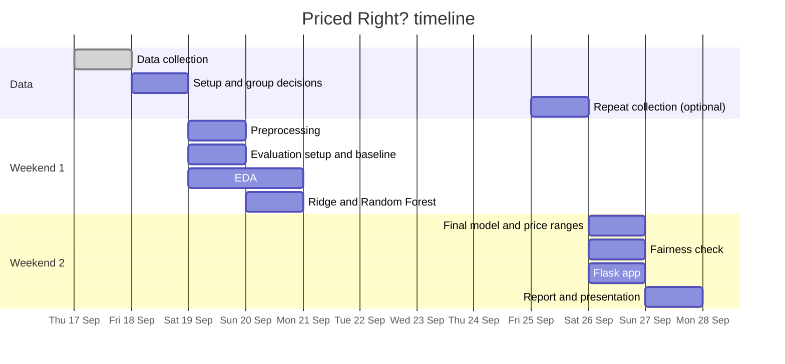
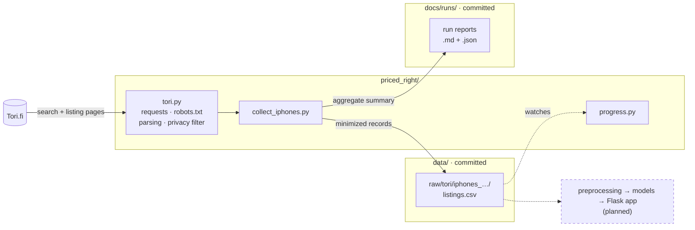

# Priced Right?

Estimating expected asking prices for second-hand listings.

Group: Abtaal Aatif, Hashir Salam Awan, Hafiz Khurram Javid

Sellers and buyers lack a reliable reference for second-hand asking prices. This project
learns an expected asking price for second-hand iPhones from comparable listings and tells
a user whether a listing sits below, in line with, or above it. Estimates reflect **asking
prices, not sale prices**: Tori never publishes what an item actually sold for, so every
claim in this project is about what sellers ask, and the report says so plainly.

Full plan: [docs/project-canvas.md](docs/project-canvas.md)

## Scope

**iPhones only.** The original plan covered phones and furniture with bicycles as a stretch
goal. We narrowed to one category because iPhones have a tight, well-defined comparable set:
Tori exposes model, storage size and a graded condition as coded attributes, so "comparable
listing" means something precise rather than a guess from free text. Categories without that
structure, clothing especially, leave brand and title text doing all the work and the residual
is mostly noise.

Narrowing also buys depth. One category collected properly beats three collected thinly, and
the interesting question is how much of the price spread is explained by the attributes Tori
already gives us.

## Roadmap

The project runs over two weekends. Tick items off here as they land.



### Done: data collection (Thu 17 Sep)

- [x] Tori.fi collector with crawler rules, privacy filtering and pause/resume
- [x] Full iPhone run: 2,178 listings in `data/raw/tori/iphones_2026-09-17T110158Z/listings.csv` ([report](docs/runs/iphones_2026-09-17T110158Z.md))

### Before Saturday 19 Sep

- [ ] Everyone: `git pull` and set up the environment (see [Setup](#setup))
- [ ] Decide on retailer listings (20% of the data): keep them with `seller_type` as a feature, model them separately, or drop them
- [ ] Decide on daily snapshots: drop them, or run one repeat collection on Fri 25 Sep to see which listings disappeared
- [ ] Split the work: preprocessing, EDA, modelling, app, report

### Weekend 1 · Sat–Sun 19–20 Sep: clean data and first models

- [ ] **Preprocessing:** drop accessories, 0 € swap ads and the 3 Samsung listings; get the exact model and battery % from title and description; fill in missing model and memory where the text allows; mark relistings → `data/processed/iphones_clean.csv`
- [ ] **EDA:** prices by model, storage, condition, seller type and region; price spread; keyword associations → notebook and figures
- [ ] **Evaluation setup:** grouped k-fold split so relistings stay together; MAE in € and median % error → reusable function
- [ ] **Models:** median baseline by model and storage, Ridge (TF-IDF + fields), Random Forest → comparison table

The median baseline is grouped by model and storage. If a fitted model does not clearly beat
that lookup table, the finding is about the problem rather than about our modelling, and it
belongs in the report either way.

### Weekend 2 · Sat–Sun 26–27 Sep: app and report

- [ ] **Final model:** pick the best model; price ranges from held-out errors; save it for the app
- [ ] **Fairness check:** error by region and seller type; privacy and misuse discussion
- [ ] **Flask app:** seller mode (expected price and range), buyer mode (below / in line / above comparable listings)
- [ ] **Report and presentation**

## Data source and collection policy

**Tori.fi.** Approved by the course supervisor.

Tori's terms restrict systematic collection without written permission, which we have not
requested. We proceed on the supervisor's approval and keep the collection deliberately
conservative so the footprint is small and the method is defensible:

- one request every 3 seconds, with jitter and exponential backoff on 429 and 5xx
- `robots.txt` checked at the start of every run and the run aborted if the search path is disallowed
- a `User-Agent` identifying the project with a working contact address
- search pages preferred over item pages wherever possible, since one request returns ~52 listings
- static attributes cached, so no listing is fetched twice
- no seller identifiers stored: Tori exposes a persistent `ownerId` on every ad and we drop it

See [docs/data-collection-notes.md](docs/data-collection-notes.md) for the crawler rules and
how Tori exposes its data, and [docs/data-dictionary.md](docs/data-dictionary.md) for the
fields we collect and what we deliberately leave out.

## Setup

Requires Python 3.11+ (3.13 recommended). From the repo root:

```bash
python3.13 -m venv .venv
source .venv/bin/activate
pip install -e ".[notebook,dev]"
```

This installs the project in editable mode, so `import priced_right` works from notebooks, scripts and the app. The optional extras are `notebook` (JupyterLab) and `dev` (pytest, ruff).

To get the exact versions the group uses, install from the lock file:

```bash
pip install -r requirements-lock.txt
pip install -e . --no-deps
```

After adding or upgrading a dependency in `pyproject.toml`, refresh the lock file with `pip freeze --exclude-editable > requirements-lock.txt` and commit both files.

## Project structure

```
priced-right/
├── README.md                        overview, setup, collection policy
├── pyproject.toml                   dependencies and package config
├── requirements-lock.txt            exact package versions for the group
│
├── priced_right/                    all Python code, one package
│   ├── tori.py                      Tori client: requests, robots.txt, parsing, privacy filter
│   ├── collect_iphones.py           full iPhone collection (search + listing pages)
│   └── progress.py                  live progress of a running collection
│
├── docs/
│   ├── project-canvas.md            the mini project canvas
│   ├── data-dictionary.md           fields we collect, why, and what we leave out
│   ├── data-collection-notes.md     crawler rules and how Tori exposes its data
│   └── runs/                        generated report for every run (committed)
│
└── data/                            collected data (committed; created by the collector)
    └── raw/tori/iphones_<time>/     records, listings.csv, failures, log
```

How the pieces fit together:



Add folders only when there is something to put in them (e.g. `notebooks/` for EDA).

`data/` is committed so the whole group works from the same dataset. Listing descriptions are
free text written by sellers, so **the repository must stay private**. A full iPhone run is about
5 MB; three weeks of daily snapshots would run to hundreds of megabytes, so revisit this before
daily collection starts.

## Data collection

Current scope: for-sale iPhone listings.

Collection runs in two stages, because they cost very differently:

**Search sweep.** Paginates the category and returns roughly 52 listings per request,
carrying price, title, location, listing age and the attribute chips. Cheap, so it runs on
every collection pass.

**Item enrichment.** One request per listing, returning the fields the search pages do not
carry: graded condition, model, storage, description, postal code and region. These never
change after a listing is posted, so each listing is fetched exactly once and cached; repeat
runs only pay for listings that appeared since the last pass.

Run from the repo root. The collection code uses only the standard library and also runs on Python 3.9. A full iPhone collection (~2 h) writes `data/raw/tori/iphones_<timestamp>/listings.csv`:

```bash
python3 -m priced_right.collect_iphones
```

## Why the daily cadence matters

Every pass writes a dated snapshot. Stacking them recovers how long each listing stayed live,
which is the only signal available on whether a price was one people acted on. That history
cannot be reconstructed after the fact: a listing that disappears is simply gone, and nothing
in Tori's data says when it went or why.

Disappearance is not the same as sold. A listing can vanish because it sold, because the
seller withdrew it, or because it expired, and nothing distinguishes those from outside. Any
use we make of it says so.
