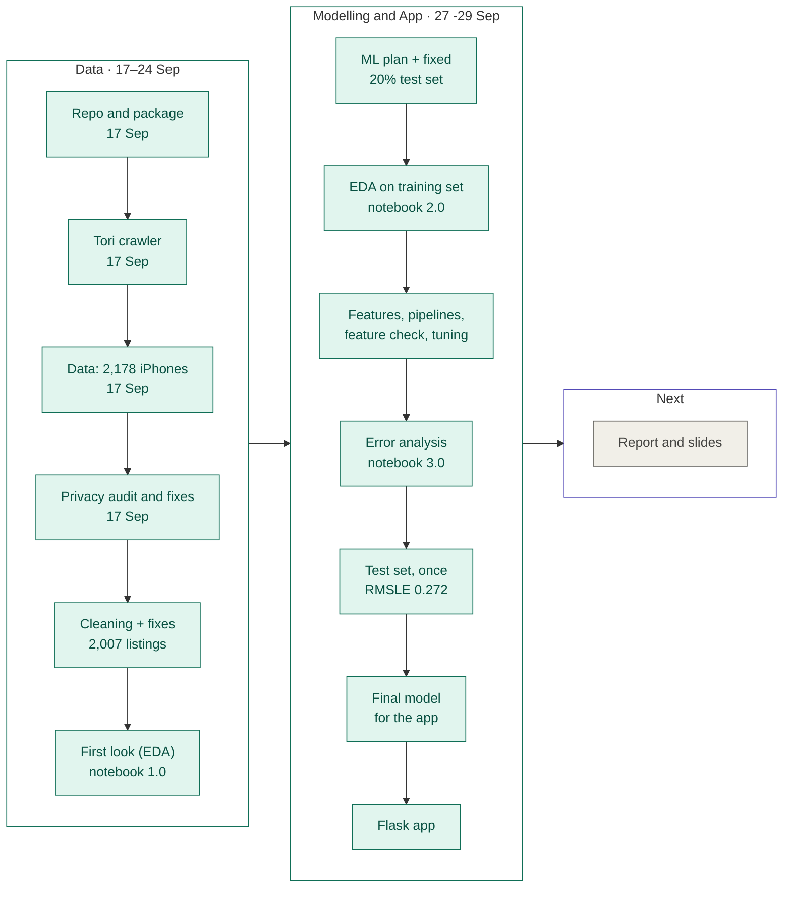
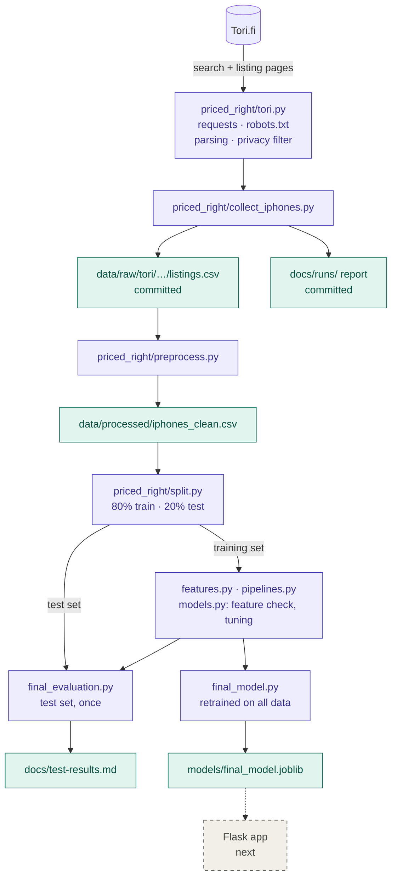

# Priced Right?

[](https://github.com/HashirSalam/priced-right/actions/workflows/tests.yml)

Estimating expected asking prices for second-hand listings.

Group: Abtaal Aatif, Hashir Salam Awan, Hafiz Khu. Javid

Sellers and buyers lack a reliable reference for second-hand asking prices. This project
learns an expected asking price for second-hand iPhones from comparable listings and tells
a user whether a listing sits below, in line with, or above it. Estimates reflect **asking
prices, not sale prices**: Tori never publishes what an item actually sold for, so every
claim in this project is about what sellers ask, and the report says so plainly.

Full plan: [docs/project-canvas.md](docs/project-canvas.md)

## Scope

**iPhones only.** The original plan covered phones and furniture with bicycles as a stretch
goal. We narrowed to one category because iPhones have a tight, well-defined comparable set:
Tori exposes model, storage size and a graded condition as coded attributes, so "comparable
listing" means something precise rather than a guess from free text. Categories without that
structure, clothing especially, leave brand and title text doing all the work and the residual
is mostly noise.

Narrowing also buys depth. One category collected properly beats three collected thinly, and
the interesting question is how much of the price spread is explained by the attributes Tori
already gives us.

## Roadmap

Where we are (updated 29 Sep): data collected and cleaned, modelling done, and Flask app completed. The full history is in [docs/project-log.md](docs/project-log.md).



### Done

- [x] Repo, `priced_right` package, docs (17 Sep)
- [x] Tori crawler: robots.txt check, ≥3 s between requests, only needed fields, contact details scrubbed, pause/resume (17 Sep)
- [x] Full iPhone run: 2,178 listings in `data/raw/tori/iphones_2026-09-17T110158Z/listings.csv` ([report](docs/runs/iphones_2026-09-17T110158Z.md))
- [x] Privacy audit: missed contact details found and removed (see [privacy validation](docs/data-collection-notes.md#privacy-validation))
- [x] **Cleaning** (`preprocess.py`): 2,007 clean listings, 51 models, derived features ([data dictionary](docs/data-dictionary.md)). Fixes: storage read as a model, spare parts, bundles, iPhone SE generations, and mention flags that ignore negations ("ei halkeamia" = no cracks)
- [x] **First look:** [notebooks/1.0-eda.ipynb](notebooks/1.0-eda.ipynb), the team's first-look steps with explanations. Price goes most with release year and storage; retailers ask more than private sellers
- [x] **ML plan** ([docs/ml-plan.md](docs/ml-plan.md)): target, metrics, success bar, allowed inputs and selection rules, all written before modelling (27 Sep)
- [x] **Test set:** 20% of listings set aside by relisting group and used once, for the final model (`split.py`)
- [x] **EDA on the training set:** [notebooks/2.0-aa-eda.ipynb](notebooks/2.0-aa-eda.ipynb). Retailers ask ~22% more for the same phone; region is mostly seller mix; box and receipt mentions make no difference
- [x] **Features and pipelines** (`features.py`, `pipelines.py`): only inputs a user can give before posting an ad; one pipeline per model
- [x] **Feature check and model choice** ([feature-check.md](docs/feature-check.md), [model-comparison.md](docs/model-comparison.md)): five models tuned on the same grouped folds; kept: phone model, condition, storage, seller type, damage; final model: gradient boosting
- [x] **Error analysis:** [notebooks/3.0-aa-error-analysis.ipynb](notebooks/3.0-aa-error-analysis.ipynb), before the test set was opened
- [x] **Test set, once** ([test-results.md](docs/test-results.md)): all success-bar criteria met; 80% price ranges; fairness by seller type and region
- [x] **Final model for the app:** retrained on all listings, with `predict()` and `options()` ([model-handover.md](docs/model-handover.md), [model-card.md](docs/model-card.md))

- [x] **Flask app** with seller and buyer modes, built on `priced_right.final_model` ([model-handover.md](docs/model-handover.md))

### Next

- [ ] **Report and slides:** methods, results, limitations ("asking prices, not sale prices")

## Results

Final model: **gradient boosting** on launch year, product line, condition, storage, seller type and damage mentions. Scored once on the 405 held-out test listings ([docs/test-results.md](docs/test-results.md)):

| | Final model | Baseline: median of the same model + storage |
|---|---|---|
| RMSLE | **0.272** (95% CI 0.242–0.302) | 0.374 |
| Mean absolute error | **46 €** | 58 € |
| Median % error | **14.3%** | 16.5% |
| 80% price ranges | cover **77%** of listings | |

RMSLE is 27% below the baseline's (95% CI 19–35%), meeting every criterion of the success bar set before modelling. Estimates are least reliable for phones under about 100 € and phones launched in 2016 or earlier; see the [model card](docs/model-card.md) for results by group and known limitations.

## Reproducing the modelling

Run from the repo root, in this order. Each step writes what the next one reads.

```bash
python -m priced_right.preprocess          # clean raw listings -> data/processed/iphones_clean.csv
python -m priced_right.split               # fixed 20% test set (already created; refuses to redraw)
python -m priced_right.models check        # feature check on the training set -> docs/feature-check.md
python -m priced_right.models tune         # tune and compare 5 models -> docs/model-comparison.md
python -m priced_right.final_evaluation    # the one-time test evaluation (already done; refuses to rerun)
python -m priced_right.final_model         # retrain on all listings -> models/final_model.joblib
```

The rules each step follows, and every change to them, are in [docs/ml-plan.md](docs/ml-plan.md).

## Data source and collection policy

**Tori.fi.** Approved by the course supervisor.

Tori's terms restrict systematic collection without written permission, which we have not
requested. We proceed on the supervisor's approval and keep the collection deliberately
conservative so the footprint is small and the method is defensible:

- one request every 3 seconds, with jitter and exponential backoff on 429 and 5xx
- `robots.txt` checked at the start of every run and the run aborted if the search path is disallowed
- a `User-Agent` identifying the project with a working contact address
- search pages preferred over item pages wherever possible, since one request returns ~52 listings
- static attributes cached, so no listing is fetched twice
- no seller identifiers stored: Tori exposes a persistent `ownerId` on every ad and we drop it

See [docs/data-collection-notes.md](docs/data-collection-notes.md) for the crawler rules and
how Tori exposes its data, and [docs/data-dictionary.md](docs/data-dictionary.md) for the
fields we collect and what we deliberately leave out.

## Setup

Requires Python 3.11+ (3.13 recommended). From the repo root:

```bash
python3.13 -m venv .venv
source .venv/bin/activate
pip install -e ".[notebook,dev]"
```

This installs the project in editable mode, so `import priced_right` works from notebooks, scripts and the app. The optional extras are `notebook` (JupyterLab) and `dev` (pytest, ruff).

To get the exact versions the group uses, install from the lock file:

```bash
pip install -r requirements-lock.txt
pip install -e . --no-deps
```

Run the checks before opening a PR:

```bash
uv run ruff check priced_right tests
uv run pytest
```

GitHub Actions runs the same two checks on every PR and on `main` ([workflow](.github/workflows/tests.yml)), installing the exact versions from `requirements-lock.txt`.

After adding or upgrading a dependency in `pyproject.toml`, refresh the lock file with `pip freeze --exclude-editable > requirements-lock.txt` and commit both files.

## Run the app

With the project environment active, run from the repo root:

```bash
python -m flask --app priced_right.app run
```

Open http://127.0.0.1:5000 in a browser. Seller mode estimates an expected asking price and 80% range. Buyer mode also compares a listing's asking price with that range. The app uses the committed `models/final_model.joblib`; estimates concern asking prices, not sale prices.

### Deploy (demo)

The app is set up for [Render](https://render.com)'s free plan in `render.yaml`: in the Render dashboard choose **New → Blueprint** and pick this repo. Render installs only `requirements-app.txt` (same versions as the lock file), runs the app with gunicorn on Python 3.13 (`.python-version`) in Frankfurt, and redeploys on every merge to `main`. The free plan sleeps after 15 idle minutes and takes about a minute to wake, so open the URL a few minutes before a demo, and keep `python -m flask --app priced_right.app run` as a local backup.

## Project structure

```
priced-right/
├── README.md                        overview, setup, collection policy
├── pyproject.toml                   dependencies and package config
├── requirements-lock.txt            exact package versions for the group
│
├── priced_right/                    all Python code, one package
│   ├── tori.py                      Tori client: requests, robots.txt, parsing, privacy filter
│   ├── collect_iphones.py           full iPhone collection (search + listing pages)
│   ├── progress.py                  live progress of a running collection
│   ├── preprocess.py                cleaning and derived features
│   ├── split.py                     the fixed 20% test set; load_train() / load_test()
│   ├── features.py                  target (log price) and model inputs
│   ├── pipelines.py                 median baseline and one pipeline per model
│   ├── evaluate.py                  scoring and grouped cross-validation
│   ├── models.py                    feature check, tuning and model choice
│   ├── ranges.py                    80% price ranges from held-out errors
│   ├── final_evaluation.py          the one-time test-set evaluation
│   └── final_model.py               final model retrained on all data; predict() and options() for the app
│
├── notebooks/
│   ├── 1.0-eda.ipynb                first look at all the data (the team's first-look session)
│   ├── 2.0-aa-eda.ipynb             EDA on the training set, with modelling decisions
│   └── 3.0-aa-error-analysis.ipynb  where the final model is wrong, before the test set was opened
│
├── models/                          model choices, results and the saved final model (committed)
├── tests/                           tests for every module (uv run pytest)
├── .github/workflows/tests.yml      lint + tests on every PR
│
├── docs/
│   ├── project-canvas.md            the mini project canvas
│   ├── data-dictionary.md           fields we collect, why, what we leave out, and the model inputs
│   ├── data-collection-notes.md     crawler rules and how Tori exposes its data
│   ├── ml-plan.md                   modelling rules, written before modelling, with a change log
│   ├── feature-check.md             which inputs each model keeps (generated)
│   ├── model-comparison.md          tuned models vs baseline, and the final choice (generated)
│   ├── test-results.md              the one-time test-set results (generated)
│   ├── model-card.md                what the final model is for, how good it is, its limits
│   ├── model-handover.md            how the app uses the final model
│   ├── project-log.md               dated history of work and decisions
│   └── runs/                        generated report for every run (committed)
│
└── data/                            collected data (committed)
    ├── raw/tori/iphones_<time>/     records, listings.csv, failures, log
    └── processed/                   iphones_clean.csv, cleaning_log.json (rebuilt by preprocess.py),
                                     test_listing_ids.csv (the fixed test set)
```

How the pieces fit together:



Add folders only when there is something to put in them. When they are needed, follow the [Cookiecutter Data Science](https://cookiecutter-data-science.drivendata.org/) conventions:

- `notebooks/`: numbered with initials, e.g. `1.0-hsa-eda.ipynb`, `2.0-aa-baseline.ipynb`
- `models/`: saved fitted pipelines for the app
- `reports/figures/`: figures for the report
- `data/processed/`: cleaned data, always rebuilt by code from `data/raw/`, which is never edited by hand

`data/` is committed so the whole group works from the same dataset. Listing descriptions are
free text written by sellers, so **the repository must stay private**. A full iPhone run is about
5 MB; three weeks of daily snapshots would run to hundreds of megabytes, so revisit this before
daily collection starts.

## Data collection

Current scope: for-sale iPhone listings.

Collection runs in two stages, because they cost very differently:

**Search sweep.** Paginates the category and returns roughly 52 listings per request,
carrying price, title, location, listing age and the attribute chips. Cheap, so it runs on
every collection pass.

**Item enrichment.** One request per listing, returning the fields the search pages do not
carry: graded condition, model, storage, description, postal code and region. These never
change after a listing is posted, so each listing is fetched exactly once and cached; repeat
runs only pay for listings that appeared since the last pass.

Run from the repo root. The collection code uses only the standard library and also runs on Python 3.9. A full iPhone collection (~2 h) writes `data/raw/tori/iphones_<timestamp>/listings.csv`:

```bash
python3 -m priced_right.collect_iphones
```

## Why the daily cadence matters

Every pass writes a dated snapshot. Stacking them recovers how long each listing stayed live,
which is the only signal available on whether a price was one people acted on. That history
cannot be reconstructed after the fact: a listing that disappears is simply gone, and nothing
in Tori's data says when it went or why.

Disappearance is not the same as sold. A listing can vanish because it sold, because the
seller withdrew it, or because it expired, and nothing distinguishes those from outside. Any
use we make of it says so.
